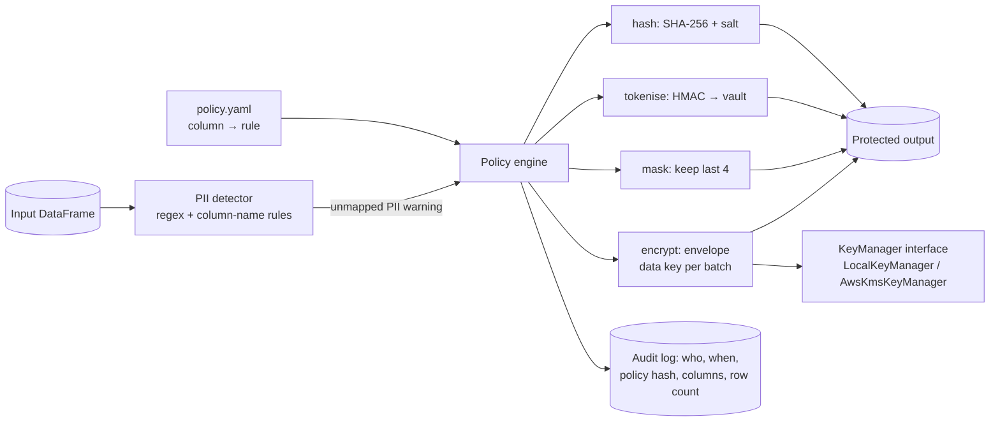

# pii-masking-toolkit

[](https://github.com/navyaajs-web/pii-masking-toolkit/actions/workflows/ci.yml)


A small PySpark library and CLI for applying column-level privacy controls from a YAML policy:
- Hashing
- Deterministic tokenisation, with a token vault
- Partial masking
- Nulling
- Envelope encryption

Every run writes an append-only audit record.

## Problem
Regulated datasets, such as banking customers and card transactions, need the same controls applied the same way in every pipeline. Ad-hoc `regexp_replace` calls scattered across jobs are hard to audit.

## Architecture


## Run it in three commands
```bash
make setup     # venv + pyspark, cryptography, pyyaml
make demo      # generates synthetic customers, applies examples/policy.yaml, prints before/after
make test
```

## What is inside
| Path | What it does |
|---|---|
| `src/pii_toolkit/policy.py` | YAML schema and validation; a policy hash is stored in the audit |
| `src/pii_toolkit/rules.py` | Spark column expressions for each rule |
| `src/pii_toolkit/envelope.py` | AES-GCM data keys wrapped by a `KeyManager`; the AWS KMS adapter is documented, not called in CI |
| `src/pii_toolkit/vault.py` | Token vault (Parquet by default; the format is configurable, e.g. Delta, but only Parquet is tested) with values encrypted at rest and re-identification restricted to a separate role |
| `src/pii_toolkit/detect.py` | Flags likely PII columns not covered by the policy |
| `src/pii_toolkit/audit.py` | Append-only audit records, hash-chained so edits are detectable |
| `src/pii_toolkit/cli.py` | `pii-toolkit validate / detect / generate / apply / demo` |
| `docs/design.md` | Rule choice, key handling, vault and audit design, known trade-offs |
| `tests/` | Determinism, irreversibility of hash, decrypt round-trip, policy validation, detector |

## What this proves
- I can turn privacy requirements into a tested, reusable library.
- I can implement envelope encryption correctly.
- I can make the controls auditable.

## Limitations
- This is a pattern demonstration, not a certified compliance product.
- Key rotation is shown for data keys only.
- The local key manager is for demos.

## About the author
Built by Navya Sindhu, Senior Data Engineer. [LinkedIn](https://www.linkedin.com/in/navyaajs/). This is a personal project with synthetic data. It contains no employer or client security designs or code.
